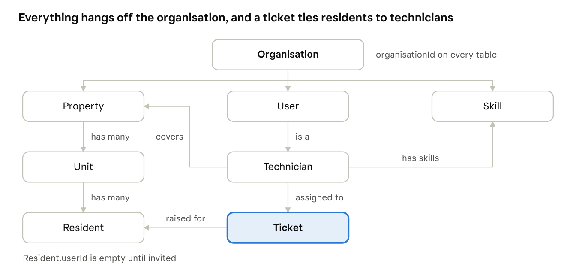
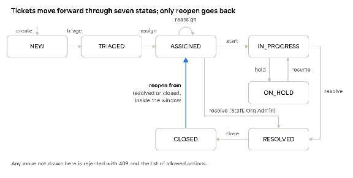

# DeskOps Phase 1: Technical Design Document

Organisation, ticket state machine and event history · Nov 14, 2026 · @Sanusi

## 1. Overview

This document specifies how DeskOps Phase 1  models organisations, runs the ticket lifecycle as a strict state machine, and records every change as an event. It is submitted for mentor approval by 14 Nov 2026 (milestone M1.1).

**Goals**

* Isolate every facilities company (tenant) so one can never read another's data (NFR-01, AC-1.1).
* Allow only legal ticket transitions, enforced in the API, not the UI (FR-1.02).
* Store every transition as an immutable event with actor and timestamp, and build the timeline from those events (FR-1.03).
* Make assignment safe under 20 parallel requests (AC-1.2, NFR-03).

**Assumptions**

* One Express service in three layers (routes, services, repositories), PostgreSQL via Prisma, Redis for queues.
* Greenfield Facilities is the seed tenant (6 properties, about 2,000 units, 60 technicians). Seed data is labelled sample data.
* SLA timers arrive in Phase 2, but the schema leaves room for them: a ticket has a priority and category now.

**Client-specific rule**

Our client is a serviced apartment company. Its extra rule has two parts: a resolved ticket can be reopened only within 7 days of being marked resolved, and whoever reopens it must pick one reason from a fixed list. The rule is the same for every role, including Org Admin; after 7 days staff create a new ticket. It is specified in Section 4.3, shapes the reopen transition in Section 5, and is covered by automated tests (Section 10).

## 2. Architecture and tenancy

Tenant isolation is enforced in one place, a request-scoped middleware plus a Prisma client extension, so no route or service can forget it (NFR-01).

**Layers**

* **Routes** parse and validate input with Zod, call one service, and shape the response. No business rules.
* **Services** hold rules: permissions, the state machine, event writing, transactions.
* **Repositories** are the only code that touches Prisma. Each receives a tenant-scoped client.

**Tenant resolution**

1. The auth middleware verifies the access token and loads the user, which carries organisationId and role.
2. A tenant middleware puts { organisationId, userId, role, requestId } into an AsyncLocalStorage request context.
3. A Prisma client extension reads that context. On every findMany, findFirst, findUnique, update, delete and count, it adds organisationId to the where. On every create, it sets organisationId from the context and ignores any value in the body.
4. A lookup by ID that belongs to another tenant matches no row, so the API returns 404, not 403. A 403 would confirm the record exists.

**Rules that back this up**

* Every table carries a non-null organisationId with an index. Composite unique constraints include it, for example (organisationId, ticketNumber).
* Raw SQL is banned in services. If a repository needs it (for a row lock, see Section 7), it must include organisationId and is covered by a tenant-isolation test.
* Background jobs carry organisationId in the payload and open the same scoped client, so workers are isolated too.
* Socket.io rooms are named org:{organisationId} and ticket:{ticketId}. A socket joins a ticket room only after the same scoped lookup succeeds.

**Verification (AC-1.1)**

Supertest creates two organisations with one ticket each. A user of A requests B's ticket by ID, lists tickets, posts a comment, and attempts a transition. Every call must return 404 or an empty list, and B's data must be unchanged.

## 3. Organisation model

A facilities company is a tenant (Organisation). Properties, units, residents, staff and technicians all hang off it, and every row carries organisationId (FR-1.01, NFR-01).

| Entity | Purpose | Key fields | Relations |
| :---- | :---- | :---- | :---- |
| Organisation | The tenant, for example Greenfield Facilities | name, slug | owns everything below |
| User | A login for staff or a resident | email, passwordHash, role, isActive | belongs to Organisation |
| Property | A building or site | name, address | has many Units |
| Unit | A flat or office | label, floor | belongs to Property |
| Resident | A person living or working in a unit | name, email, phone, stayStart, stayEnd, userId (optional) | belongs to Unit; optional User for portal login |
| Technician | A staff member who does the work | userId, isActive | has many Skills and covered Properties |
| Skill | A trade such as plumbing or electrical | name | many-to-many with Technician; used as ticket category |
| TechnicianSkill | Join: technician has skill | technicianId, skillId | unique pair |
| TechnicianProperty | Join: technician covers property | technicianId, propertyId | unique pair |

**Design decisions**

* **Residents and users are separate.** A resident can exist before they ever log in (for example, created from an inbound email). Resident.userId is null until they accept an invitation.
* **Skill doubles as ticket category.** Ticket.categoryId points to a Skill. This gives routing a ready rule in Phase 2: a technician is eligible when they have the skill and cover the property.
* **Unit belongs to Property, Property to Organisation.** Both carry organisationId directly, so scoping never needs a join.
* **Soft deactivation, no hard delete.** Properties, units, technicians and users get isActive or archivedAt, because tickets and events must keep pointing at them.
* **Reopen window is fixed, not a setting.** It is the client's 7-day rule, a constant in code (Section 4.3). Staff and technician building scope uses two join tables, StaffProperty and TechnicianProperty, managed by the Org Admin. Residents have a stay (stayStart, stayEnd) and can create tickets only while it is active.

**Prisma sketch (core tables)**

```prisma
model Organisation {
  id                 String   @id @default(uuid())
  name               String
  slug               String   @unique
  // reopen window is fixed at 7 days, see Section 4.3
  createdAt          DateTime @default(now())
}

model Property {
  id             String @id @default(uuid())
  organisationId String
  name           String
  address        String
  units          Unit[]
  @@index([organisationId])
}

model Unit {
  id             String @id @default(uuid())
  organisationId String
  propertyId     String
  label          String
  floor          Int?
  property       Property @relation(fields: [propertyId], references: [id])
  @@unique([organisationId, propertyId, label])
}

model Technician {
  id             String @id @default(uuid())
  organisationId String
  userId         String @unique
  isActive       Boolean @default(true)
  skills         TechnicianSkill[]
  properties     TechnicianProperty[]
  @@index([organisationId])
}
```

The diagram below shows how the entities connect.



*Organisation model · 8 entities*

Technician-to-skill and technician-to-property links are the two join tables above. Ticket is specified in Section 5.

## 4. Roles and permission matrix

This matrix is the team's single reference for who may do what, by role and action (NFR-02). It lives in code as one typed map, can(role, action), and a test per protected route checks one permitted and one denied role. The PRD lists no roles, so the four below are derived from its text (resident, technician, staff, tenant admin) and are open for mentor confirmation. Status: the team reads the PRD and agrees this matrix before the design is approved on 14 Nov.

**Roles**

| Role | Who they are | Scope |
| :---- | :---- | :---- |
| Resident | Current occupant (guest or long-stay tenant) of a unit | Own unit and own tickets; access follows their stay |
| Staff (service desk) | Operations employee of the apartment company | Only the buildings (properties) they are assigned to; may cover several |
| Technician | Field worker with skills and covered properties (FR-1.01) | Only tickets assigned to them |
| Org Admin | Manager of one company's account | Whole own organisation, never another company |

The system actor is not a role. When an inbound email arrives, the system creates the ticket (actorType EMAIL). It can only create tickets or add public replies.

The Org Admin looks after the whole company, which has several buildings. Each building has its own Staff, who manage that building's residents and tickets; Staff in one building cannot see another building's tickets. The Org Admin decides which Staff and technicians belong to which building, through StaffProperty and TechnicianProperty links.

**How to read the tables:** "Yes" means allowed, "No" means denied, and any other text means allowed only under that condition. Conditions are checked in the service after the tenant-scoped lookup, and building scope is applied in the repository query.

### 4.1 Tickets

| Action | Resident | Staff | Technician | Org Admin | Why |
| :---- | :---- | :---- | :---- | :---- | :---- |
| Create ticket | Own unit, while occupying | Yes | No | Yes | Residents are the source of requests, only for the unit they occupy. Staff create for phone and front-desk callers. Technicians fix work and do not intake it |
| View ticket list and detail | Own tickets | Assigned buildings | Assigned tickets | Whole own org | Each role sees the minimum it needs. Residents must not see other guests' complaints |
| Edit details (title, category, priority) | No | Yes | No | Yes | Category and priority drive triage and later SLA. Residents add information through comments |
| View event timeline | Resident-visible entries only | Yes, on tickets they can view | Assigned tickets | Yes | Residents see status changes and their own reopen reasons, not internal notes or merge detail |

### 4.2 Lifecycle transitions (FR-1.02)

| Action | Resident | Staff | Technician | Org Admin | Why |
| :---- | :---- | :---- | :---- | :---- | :---- |
| Triage (new to triaged) | No | Yes | No | Yes | Reviewing and prioritising is the service desk's core job |
| Assign or reassign technician | No | Yes | No | Yes | Staff know skills and coverage. Technicians must not pick their own jobs. Few callers keeps the 20-parallel-request test (AC-1.2) simple |
| Start work (assigned to in progress) | No | No | Only if assigned | Yes, as override | Only the person doing the work knows when it began. Admin steps in if the technician is unreachable, and it is logged |
| Put on hold or resume | No | Yes | Only if assigned | Yes | The technician knows when access or parts are missing. Staff also arrange access with residents |
| Mark resolved | No | Yes | Only if assigned | Yes | The technician confirms the fix. Staff can resolve straight from ASSIGNED when a technician reports by phone. This starts the 7-day reopen clock |
| Close (resolved to closed) | No | Yes | Only if assigned | Yes | The assigned technician can close the job they fixed, as the PRD says, and Staff can close too, for example after a phone report. Closing does not stop the 7-day clock |
| Reopen | Own ticket, within 7 days, reason required | Within 7 days, reason required | No | Within 7 days, reason required | The resident knows best that the problem is back; Staff can reopen for them. Technicians do not reopen their own work |
| Reopen after 7 days | No | No | No | No | The client's rule (4.3). Nobody gets an exception; staff create a new ticket |
| Merge duplicate (CR-1) | No | Yes | No | Yes | Merging closes one ticket and moves its comments and watchers, and is hard to undo. A ticket closed by merge cannot be reopened; reopen the original |

### 4.3 Our client's reopen rule (FR-1.08)

Our client is a serviced apartment company. Its extra rule has two parts, and it is the same for every role, including Org Admin:

* A resolved ticket can be reopened only within 7 days of being marked resolved. After that, staff create a new ticket instead.
* Whoever reopens it must pick one reason from a fixed list. No free typing.

Example: a ticket is marked resolved on 1 Dec. Reopening on 6 Dec works. Reopening on 9 Dec is refused.

Reasons (proposed, to be confirmed): problem not fixed, problem came back, repair only partly done, repair caused a new problem, marked resolved by mistake.

**How it is built**

* The window is a constant, REOPEN_WINDOW_DAYS = 7, not a database setting, and no screen or endpoint can change it. It is measured as 7 x 24 hours from Ticket.resolvedAt, using UTC timestamps, and the limit itself is inclusive.
* The clock starts at resolve and keeps running through close. If a reopened ticket is resolved again, resolvedAt is set again and a new 7 days begin.
* The reason is a Zod enum (NOT_FIXED, CAME_BACK, PARTLY_DONE, CAUSED_NEW_PROBLEM, MARKED_RESOLVED_BY_MISTAKE) mirrored by a database enum. It is stored in the REOPENED event's data and shown to residents on their timeline. Free text or an unlisted value returns 422.
* Past the window the API returns 409 REOPEN_WINDOW_EXPIRED for every role. A ticket closed by merge cannot be reopened.
* The service takes its clock from an injectable function, so tests can set resolve time and now without waiting.

### 4.4 Comments (FR-1.07)

| Action | Resident | Staff | Technician | Org Admin | Why |
| :---- | :---- | :---- | :---- | :---- | :---- |
| Add public comment | Own tickets | Yes | Assigned tickets | Yes | Two-way conversation with the resident is the point of public comments |
| Add internal comment | No | Yes | Assigned tickets | Yes | Internal notes are staff-only by definition. If a resident could write one, the visibility rule would mean nothing |
| Read public comments | Own tickets | Yes | Assigned tickets | Yes | Everyone involved needs the conversation |
| Read internal comments | No | Yes | Assigned tickets | Yes | The API filters internal comments server-side, including real-time payloads and the timeline |
| Edit own comment | Within 10 minutes | Within 10 minutes | Within 10 minutes | No | Same window as delete. The previous version stays in the audit log. Admins do not edit other people's words |
| Delete own comment | Within 10 minutes | Within 10 minutes | Within 10 minutes | Yes, any time | Soft delete: the screen shows "comment removed by author" and the original text stays in the audit log. After the window others may have acted on it, so only an admin can remove it |
| Delete another person's comment | No | No | No | Yes | Used for abusive or sensitive content. Always audited |

### 4.5 Attachments (FR-1.04) and watchers

| Action | Resident | Staff | Technician | Org Admin | Why |
| :---- | :---- | :---- | :---- | :---- | :---- |
| Request presigned upload and attach file | Own tickets | Yes | Assigned tickets | Yes | Photos help diagnosis and prove the fix. The server checks size and real file type for every role |
| View or download attachment | Own tickets | Yes | Assigned tickets | Yes | Follows ticket visibility. Download URLs are short-lived and checked per request |
| Delete attachment | No | No | No | Yes | Deleting evidence is rare, so it is admin-only and audited |
| Watch a ticket | Own tickets | Yes | Assigned tickets | Yes | Watching never widens access: you can only follow what you can already see |
| Add or remove other watchers | No | Yes | No | Yes | Staff loop in colleagues and contacts |

### 4.6 Organisation administration (FR-1.01) and operations

| Action | Resident | Staff | Technician | Org Admin | Why |
| :---- | :---- | :---- | :---- | :---- | :---- |
| Manage properties and units | No | No | No | Yes | These define the tenant structure tickets hang from |
| Invite users and assign roles | No | No | No | Yes | The most sensitive permission, since it can grant all others |
| Manage technician skills, coverage and staff buildings | No | No | No | Yes | Assignment quality depends on this data; admin-only stops accidental edits |
| View technician list (for assignment) | No | Yes, name, skills and coverage only | No | Yes | Staff cannot assign without it but do not need contact details |
| View resident contact details | No | Only on tickets they handle | Only unit and access info on assigned tickets | On request, logged | Privacy: guests' phone numbers and stay dates are shown only where the job needs them |
| Change org settings (categories, notifications) | No | No | No | Yes | Settings change behaviour for the whole organisation |
| Change reopen window or reason list | No | No | No | No | Fixed by the client rule (7 days, fixed reasons). No screen can change it |
| View audit log (NFR-09) | No | No | No | Yes | Reveals actors and internal activity |
| View and replay dead-letter jobs (NFR-06) | No | No | No | Yes | Replaying can re-send emails or reprocess files |

### 4.7 Cross-tenant rule (applies to every row)

A user from organisation A who requests any record of organisation B receives 404, whatever their role, including Org Admin. The organisation ID comes from the authenticated token, never from the request body or URL. An Org Admin oversees only their own company.

### 4.8 Team agreement

Each team member reads the PRD and this matrix, and records agreement before the design goes to the mentor on 14 Nov.

| Team member | Read PRD and agrees to matrix |
| :---- | :---- |
| Audu Sanusi | Done |
| Piyush Rastogi | Done |
| Shaikh Rahmat | Done |

## 5. Ticket state machine

A ticket is always in one of seven states and moves only along the transitions below. The rules are stored as a data table in code, so adding or changing a transition (such as the CR-1 merge in Section 9) is a one-row change (FR-1.02).

**States:** NEW, TRIAGED, ASSIGNED, IN_PROGRESS, ON_HOLD, RESOLVED, CLOSED.

| Action | From | To | Who | Guard and required input |
| :---- | :---- | :---- | :---- | :---- |
| create | none | NEW | Resident (own unit, while occupying), Staff, Org Admin, email webhook | Unit belongs to an active building in the organisation; staff scope covers it |
| triage | NEW | TRIAGED | Staff, Org Admin | Category (skill) and priority set |
| assign | TRIAGED | ASSIGNED | Staff, Org Admin | Technician is active, has the category skill and covers the building |
| reassign | ASSIGNED | ASSIGNED | Staff, Org Admin | Same checks as assign; state unchanged, event recorded |
| start | ASSIGNED | IN_PROGRESS | Assigned technician; Org Admin as override | Override is logged in the event |
| hold | IN_PROGRESS | ON_HOLD | Assigned technician, Staff, Org Admin | Reason required |
| resume | ON_HOLD | IN_PROGRESS | Assigned technician, Staff, Org Admin | None |
| resolve | IN_PROGRESS, or ASSIGNED (Staff and Org Admin only) | RESOLVED | Assigned technician, Staff, Org Admin | Resolution note required; sets resolvedAt and starts the 7-day reopen clock. Resolving from ASSIGNED (for example after a phone report) skips IN_PROGRESS and the event records that |
| close | RESOLVED | CLOSED | Assigned technician, Staff, Org Admin | None; does not stop the reopen clock |
| reopen | RESOLVED or CLOSED | ASSIGNED | Resident (own ticket), Staff, Org Admin | At most 7 x 24 hours since resolvedAt, for every role; reason from the fixed list (Section 4.3); ticket not closed by merge |

Anything not in this table is illegal, including skipping states (NEW straight to ASSIGNED) and moving backwards (IN_PROGRESS to TRIAGED).

The diagram below shows the same transitions.



*Ticket state machine · 7 states*

Reassign keeps the ticket in ASSIGNED, so it shows as a loop. The accent line is the only backward move.

**Enforcement**

* A single TicketStateMachine.transition(ticketId, action, input) service method is the only code that changes Ticket.status. Routes expose one endpoint per action (Section 8); no endpoint accepts a free status field.
* Failures use the uniform error format: ILLEGAL_TRANSITION (409, with currentStatus and allowedActions), FORBIDDEN_ACTION (403 for a role that cannot act on a ticket it can see), GUARD_FAILED (422, for example no resolution note), and REOPEN_WINDOW_EXPIRED (409; staff create a new ticket instead).
* The reopen target is ASSIGNED so the same technician sees it again; if that technician is inactive, the ticket returns to TRIAGED. This is recorded as an ADR.

## 6. Event history

Every state change, assignment and comment is an immutable TicketEvent written in the same database transaction as the change itself. The ticket timeline is built only from these events (FR-1.03).

**Ticket and event models**

```prisma
enum TicketStatus { NEW TRIAGED ASSIGNED IN_PROGRESS ON_HOLD RESOLVED CLOSED }

model Ticket {
  id             String       @id @default(uuid())
  organisationId String
  number         Int
  propertyId     String
  unitId         String
  residentId     String
  categoryId     String?
  priority       Priority     @default(NORMAL)
  title          String
  description    String
  status         TicketStatus @default(NEW)
  assigneeId     String?
  resolvedAt     DateTime?
  version        Int          @default(1)
  source         TicketSource @default(PORTAL)
  createdAt      DateTime     @default(now())
  updatedAt      DateTime     @updatedAt
  events         TicketEvent[]
  @@unique([organisationId, number])
  @@index([organisationId, status])
  @@index([organisationId, assigneeId])
}

model TicketEvent {
  id             String     @id @default(uuid())
  organisationId String
  ticketId       String
  seq            Int
  type           EventType
  fromStatus     TicketStatus?
  toStatus       TicketStatus?
  actorId        String?
  actorType      ActorType
  visibility     Visibility @default(PUBLIC)
  data           Json?
  createdAt      DateTime   @default(now())
  ticket         Ticket     @relation(fields: [ticketId], references: [id])
  @@unique([ticketId, seq])
  @@index([organisationId, ticketId, seq])
}
```

**Field rules**

| Field | Rule |
| :---- | :---- |
| type | CREATED, TRIAGED, ASSIGNED, REASSIGNED, STARTED, PUT_ON_HOLD, RESUMED, RESOLVED, CLOSED, REOPENED, COMMENT_ADDED, COMMENT_EDITED, COMMENT_DELETED, ATTACHMENT_ADDED, ATTACHMENT_DELETED, MERGED_INTO, MERGED_FROM, COMMENT_MOVED |
| actorId, actorType | The user, or null with actorType SYSTEM or EMAIL for the webhook and workers. Never trust an actor id from the request body |
| seq | Equals the ticket's version after the change. The unique key (ticketId, seq) makes a duplicate or out-of-order write fail |
| fromStatus, toStatus | Set on status changes; null for comments and attachments |
| data | Small JSON for the change: technician id, hold reason, resolution note, reopen reason (one of five fixed codes) |
| visibility | PUBLIC events (status changes, public comments, reopen reasons) show to the resident; INTERNAL events (internal comments, merge events, internal notes) do not |
| createdAt | Server time, set by the database |

**Write path (one transaction)**

1. Lock the ticket row (Section 7) and read its status and version.
2. Check role and guards against the transition table.
3. Update status, related fields and version = version + 1.
4. Insert the TicketEvent with seq equal to the new version.
5. Commit. Only after commit, publish ticket.event to Socket.io rooms org:{id} and ticket:{id} (FR-1.06). A rolled-back change never reaches clients.

**Immutability**

* The repository for events exposes append and list only, with no update or delete.
* A Prisma migration adds a database trigger that rejects UPDATE and DELETE on TicketEvent, so a bug or a later developer cannot rewrite history. Corrections are new events.

**Reading the timeline**

* GET /api/v1/tickets/:id/events returns events ordered by seq, cursor-paginated, scoped to the organisation.
* For a resident the query adds visibility = PUBLIC in the repository, not in the UI.
* A client that reconnects after a dropped socket asks for events after its last known seq and fills the gap.

**Relationship to the audit view (NFR-09)**

Ticket events are the audit trail for tickets. Other business-critical records (organisation settings, users and roles, technician skills and coverage, staff building assignments, comment edits and deletes with the previous text, attachment deletes) write to a general AuditLog table with actor, entity, before and after values, and timestamp, through the same repository hook. The admin audit view reads both.

## 7. Concurrency and idempotency

Twenty parallel "assign" requests on one ticket must produce exactly one assignment (AC-1.2, NFR-03). The design serialises writes per ticket with a row lock and lets the state machine reject the losers.

**Row lock inside the transaction**

```ts
await prisma.$transaction(async (tx) => {
  const [t] = await tx.$queryRaw`
    SELECT id, status, version FROM "Ticket"
    WHERE id = ${ticketId} AND "organisationId" = ${orgId}
    FOR UPDATE`;
  if (!t) throw new NotFound();            // also covers other tenants
  machine.assertAllowed(t.status, 'assign', actor); // 409 if not TRIAGED
  await tx.ticket.update({ where: { id: ticketId },
    data: { status: 'ASSIGNED', assigneeId, version: { increment: 1 } } });
  await tx.ticketEvent.create({ data: { /* seq = t.version + 1 */ } });
});
```

**What happens with 20 parallel requests**

1. All 20 reach the database; the first takes the lock, the other 19 wait.
2. The first moves the ticket from TRIAGED to ASSIGNED, writes one ASSIGNED event and commits.
3. Each waiting request then reads the new status, ASSIGNED, and assign is no longer legal from it. It returns 409 ILLEGAL_TRANSITION.
4. Result: one 200, nineteen 409, one assignee, one ASSIGNED event.

**Second line of defence**

* The unique key (ticketId, seq) on TicketEvent fails any write that tries to reuse a version, even if a code path ever skipped the lock.
* The UI sends `If-Match: <version>` on action calls. A stale version returns 412, so two staff members looking at the same screen do not silently overwrite each other. The header is optional for API clients; the lock protects them anyway.
* Locks are held for one short transaction. Nothing slow (email, thumbnails, socket emits) runs inside it.

**Idempotency keys on create endpoints (NFR-04)**

Clients send an Idempotency-Key header on POST /tickets and POST /tickets/:id/comments. An IdempotencyKey table with unique (organisationId, key) stores a request hash and the saved response. A retry with the same key and body returns the saved response; the same key with a different body returns 422. The inbound email webhook uses the provider's message ID as its key, so a redelivered email never creates a second ticket.

**Verification**

A Supertest case fires 20 assign calls with Promise.all on one TRIAGED ticket, then asserts one 200, nineteen 409, one ASSIGNED event, and version raised by exactly 1. A second case does the same with resolve and with close.

## 8. API design

All routes live under /api/v1, validate input with Zod, and are published as OpenAPI at /docs (NFR-04). One endpoint exists per action, so the API cannot be used to set a status directly.

| Method and path | Purpose | Roles |
| :---- | :---- | :---- |
| POST /tickets | Create ticket (Idempotency-Key) | Resident (own unit, while occupying), Staff, Org Admin |
| GET /tickets | List, cursor-paginated, filter by status, building, assignee | By role scope |
| GET /tickets/:id | Ticket detail | By role scope |
| PATCH /tickets/:id | Edit title, category, priority | Staff, Org Admin |
| POST /tickets/:id/triage | NEW to TRIAGED | Staff, Org Admin |
| POST /tickets/:id/assign | TRIAGED to ASSIGNED | Staff, Org Admin |
| POST /tickets/:id/reassign | Change assignee | Staff, Org Admin |
| POST /tickets/:id/start | ASSIGNED to IN_PROGRESS | Assigned technician; Org Admin override |
| POST /tickets/:id/hold, /resume, /resolve | Work actions | Assigned technician, Staff, Org Admin |
| POST /tickets/:id/close | RESOLVED to CLOSED | Assigned technician, Staff, Org Admin |
| POST /tickets/:id/reopen | Reopen with { reason } inside 7 days | Resident (own), Staff, Org Admin |
| POST /tickets/:id/merge | CR-1 merge, with { intoTicketId } | Staff, Org Admin |
| GET /tickets/:id/events | Timeline, ordered by seq | By role scope |
| POST and GET /tickets/:id/comments | Public or internal comment | By matrix |
| PATCH and DELETE /comments/:id | Edit or delete (10-minute author window; admin any time for delete) | By matrix |
| POST and DELETE /tickets/:id/watchers | Add or remove watchers | Staff, Org Admin |
| GET /organisation, /properties, /units, /technicians, /skills | Reference data | Staff (technician list limited); Org Admin writes |
| GET /audit, GET and POST /admin/dead-letter | Audit view, failed jobs and replay | Org Admin |

**Conventions**

* **Errors** use one shape: { "error": { "code": "ILLEGAL_TRANSITION", "message": "...", "details": {}, "requestId": "..." } }.
* **Pagination** is cursor-based: `?limit=25&cursor=<opaque>`, response { items, nextCursor }. Lists sort by (createdAt, id) so pages are stable.
* **Status codes**: 400 bad input, 401 not signed in, 403 role cannot do this, 404 not found or other tenant, 409 illegal transition, 412 stale version, 422 guard failed.
* **Request ID** is set by middleware, logged in every pino line and returned in errors and the X-Request-Id header.

**Real-time events (Socket.io)**

The server emits ticket.event with the new TicketEvent to ticket:{id} and a smaller ticket.updated summary (id, status, assignee, version) to org:{id}. Staff join the organisation room; a resident joins only rooms for their own tickets. Payloads for residents exclude INTERNAL events.

## 9. Comments and change request CR-1

**Comments (FR-1.07)**

A Comment has organisationId, ticketId, authorId (or null for email), body and visibility (PUBLIC or INTERNAL). Adding one writes a COMMENT_ADDED event with the same visibility and the comment ID in data. Residents can only create PUBLIC comments and never receive INTERNAL ones in lists, timelines or socket payloads. TicketWatcher links a user to a ticket with a unique (ticketId, userId) pair; the creator and the assignee are added automatically. Authors may edit or delete their own comment within 10 minutes; a delete is soft, the screen shows "comment removed by author" and the old text stays in the audit log. Only an Org Admin can delete another person's comment or delete after the window (Section 4.4).

**CR-1: merge duplicate tickets (issued 21 Nov)**

The duplicate closes, and its comments and watchers move to the original. The design makes this an addition, not a rework, because the state table is data and comments and watchers already hang off ticketId.

* **New transition merge**: from NEW, TRIAGED, ASSIGNED, IN_PROGRESS or ON_HOLD to CLOSED, by Staff or Org Admin. It is the only way to CLOSED other than close.
* **Guards**: both tickets are in the same organisation; they are different tickets; the original is not CLOSED and is not itself a merged duplicate (no chains); the duplicate is not RESOLVED or CLOSED. A ticket closed by merge cannot be reopened; staff reopen the original.
* **Endpoint**: POST /tickets/:id/merge with { intoTicketId }, where :id is the duplicate.
* **One transaction**: lock both rows in ascending ID order (so two merges cannot deadlock), set the duplicate to CLOSED with closedReason = MERGED and mergedIntoId, move its comments, move its watchers (skipping users who already watch the original), and write events.
* **Events**: the duplicate gets MERGED_INTO. The original gets MERGED_FROM and one COMMENT_MOVED event per moved comment, carrying the comment's original timestamp in data. Old events are never edited, so the immutability rule holds.
* **Schema change** (one migration): Ticket.closedReason, Ticket.mergedIntoId, Comment.originalTicketId, and the new event types.

**Impact estimate for the release notes (AC-1.4)**

| What changes | Effort (estimate) | Risk | Mitigation |
| :---- | :---- | :---- | :---- |
| One migration, one transition row, one service method, one endpoint | About 1 day backend | Partial move leaves comments split | Single transaction; test forces a failure mid-merge and checks nothing moved |
| Merge action and confirmation dialog in the ticket screen | About 0.5 day frontend | Wrong ticket picked | Dialog shows both ticket numbers and titles |
| Tests: tenant isolation, permissions, concurrent merges, watcher de-duplication | About 1 day | Deadlock on opposite merges | Lock order by ID; test merges A into B and B into A in parallel |
| Real-time and timeline rendering of merged events | About 0.5 day | Stale view on the duplicate | Emit to both ticket rooms after commit |

Total estimate: about 3 person-days, which fits inside the 21 Nov to 7 Dec window. The figures are planning estimates and are replaced with actuals in the release notes.

## 10. Testing, delivery plan, risks and ADRs

**Tests that prove this design**

| Test | Covers | Requirement |
| :---- | :---- | :---- |
| Org A user requests org B ticket, list, comment and transition: 404 or empty, data unchanged | Tenant scoping | NFR-01, AC-1.1 |
| One permitted and one denied role per protected route | Permission matrix | NFR-02 |
| Every legal transition succeeds; every other state and action pair returns 409 | State machine | FR-1.02 |
| 20 parallel assign: one 200, nineteen 409, one event | Row lock | NFR-03, AC-1.2 |
| Event written with each transition, with actor, timestamp and seq; UPDATE and DELETE on events fail | Event history | FR-1.03 |
| Resident timeline and socket payload contain no INTERNAL events | Visibility | FR-1.07 |
| Resolved on 1 Dec: reopen on 6 Dec works, on 9 Dec returns REOPEN_WINDOW_EXPIRED for Resident, Staff and Org Admin alike (injected clock); missing or unlisted reason returns 422; Technician reopen returns 403 | Reopen rule | FR-1.02 |
| Same Idempotency-Key twice creates one ticket | Idempotency | NFR-04 |
| Playwright: resident raises, staff triage and assign, technician resolves and closes, resident reopens with a reason | Main journey | NFR-10, AC-1.3 |

Target: 70% coverage on services, all tests in CI.

**Delivery plan against milestones**

| Date | Milestone | What this design needs by then |
| :---- | :---- | :---- |
| 16 Nov 2026 | M1.1 Design approved | This document, with the client rule filled in and the permission matrix agreed by the team |
| 18 Nov 2026 | M1.2 Walking skeleton | Repo, Docker, CI, auth, tenant middleware and Prisma extension, with the isolation test passing |
| 20 Nov 2026 | M1.3 Core flows on staging | Organisation model, full state machine, events, concurrency test, comments |
| 21 Nov 2026 | M1.4 CR-1 issued | Merge impact estimate written from Section 9 |
| 2 Dec 2026 | M1.5 Submission opens | Merge live, client rule tested, Lighthouse and test report ready |
| 7 Dec 2026, 11:59 pm IST | M1.6 v1.0.0 | Tagged, deployed, runbook and release notes |

**Risks**

* **Design approval slips past 14 Nov.** Mitigation: build the skeleton in parallel, as the PRD allows.
* **Tenant filter missed by a raw query.** Mitigation: raw SQL only in repositories, each covered by an isolation test; CI search for $queryRaw outside repositories.
* **Lock contention on busy tickets.** Mitigation: short transactions with no external calls inside.
* **Client rule changes the state machine late.** Mitigation: table-driven transitions and event types that can be extended by migration.

**Architecture decision records to write (one page each, in /docs/adr)**

1. Tenant scoping through a Prisma client extension and request context.
2. Return 404, not 403, for other tenants' records.
3. Table-driven state machine with one transition service.
4. Row lock plus (ticketId, seq) unique key for concurrency.
5. Immutable events enforced by a database trigger.
6. Reopen target is ASSIGNED, falling back to TRIAGED; the 7-day window and the reason list are fixed constants.
7. Residents and users are separate records.

**Client-specific rule (FR-1.08)**

The 7-day reopen limit and fixed reason list are specified in Section 4.3 and enforced in the reopen transition (Section 5). They are covered by the reopen tests in the table above, which also include a Technician denial and the merged-ticket case.
